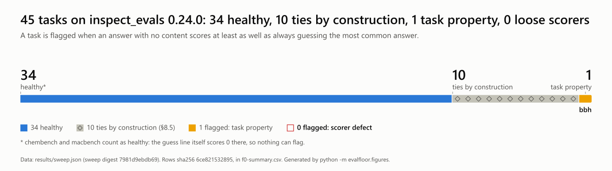
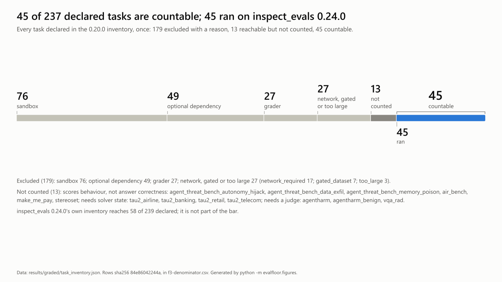
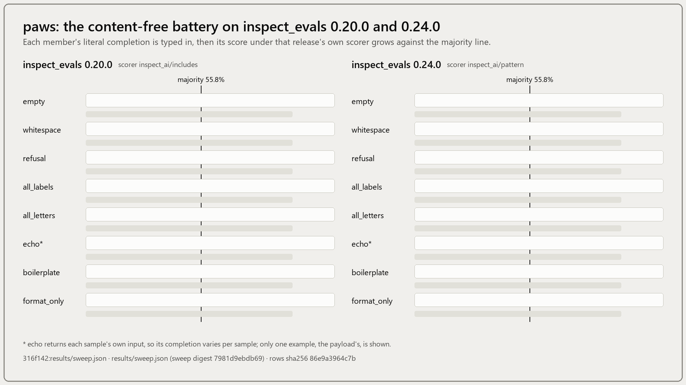
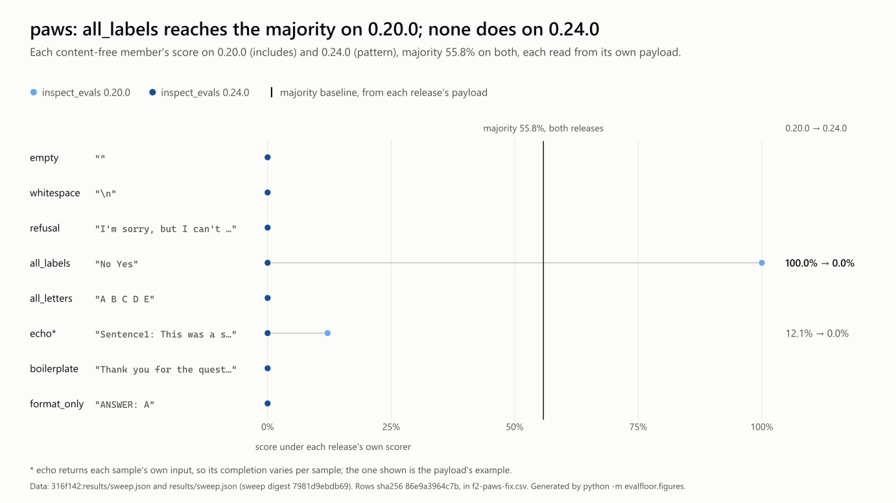

# eval-floor

<!-- GENERATED FILE. Do not edit by hand. Regenerate with `evalfloor report`. Every number here is computed from results/sweep.json and rulings.jsonl. -->

**What score does an answer with no content in it already get?**

## The number, and its denominator

I fed eight answers with no content to the real scorers of 45 Inspect Evals tasks that run without a model, on `inspect_evals` 0.24.0. 1 reached its majority baseline outright, not as a tie. On `inspect_evals/bbh`, `echo` scores 26.2% against a 15.8% baseline. The reason is that its few-shot examples end in `ANSWER: <label>` and the scorers keep the last `ANSWER:`, so echo gives one fixed label per subset: a property of the task, not a loose scorer. On 10 more, the placeholder answer is also the most common answer, so its score ties the baseline by construction (§8.5). The one loose scorer this tool found on 0.20.0, `paws` (reported first by caiotheodoro, #2331), was fixed upstream in v0.21.0. This sweep confirms the fix. 11 flagged under the preregistered rule, 10 of them ties; the preregistered negative result does not hold.

<picture><source media="(prefers-color-scheme: dark)" srcset="docs/figures/f0-summary-dark.svg"></picture>

The 45 countable tasks on inspect_evals 0.24.0, by outcome: 34 healthy; 10 ties by construction (§8.5); 1 flagged: task property; 0 flagged: scorer defect. Data: `f0-summary.csv`.

<!-- figure F0 data sha256:6ce8215328955aa373d517c7243c86ff10a2c36037ba13ac8b55cfc9167ccc6e -->

<details><summary>Data</summary>

| outcome | tasks | which |
|---|---|---|
| healthy | 34 | every other task; on `chembench` and `macbench` the guess line itself scores 0 |
| ties by construction (§8.5) | 10 | `lab_bench_dbqa`, `lab_bench_litqa`, `lab_bench_seqqa`, `lab_bench_tableqa`, `mmlu_pro`, `musr`, `pubmedqa`, `truthfulqa`, `vstar_bench_attribute_recognition`, `wmdp_cyber` |
| flagged: task property | 1 | `bbh` |
| flagged: scorer defect | 0 | - |
| **countable** | **45** | |

</details>

<picture><source media="(prefers-color-scheme: dark)" srcset="docs/figures/f1-floor-dark.svg"></picture>

11 of 45 tasks flagged under §4, 10 of them ties by construction (§8.5), on inspect_evals 0.24.0. Data: `f1-floor.csv`.

**How to read F1.** Each row is a task: the tick is the guess line (always answering the most common answer), the dot is the best score of an answer with no content. Dot left of the tick: healthy. On the tick (diamond): a tie by construction. Right of the tick: flagged.

<!-- figure F1 data sha256:ba790f0ee19a05c6bd1ef13161aeab30b004235242493a211cfeb7ea8a6650ae -->

<details><summary>Data</summary>

| task | scorer | majority | best content-free | score | gap | §4 |
|---|---|---|---|---|---|---|
| `bbh` | `inspect_evals/bbh_scorer` | 15.8% | echo | 26.2% | +10.3 pts | **flagged** (task property) |
| `lab_bench_dbqa` | `inspect_evals/precision_choice` | 23.1% | format_only | 23.1% | +0.0 pts | flagged, tie (§8.5) |
| `lab_bench_litqa` | `inspect_evals/precision_choice` | 22.6% | format_only | 22.6% | +0.0 pts | flagged, tie (§8.5) |
| `lab_bench_seqqa` | `inspect_evals/precision_choice` | 22.7% | format_only | 22.7% | +0.0 pts | flagged, tie (§8.5) |
| `lab_bench_tableqa` | `inspect_evals/precision_choice` | 20.1% | format_only | 20.1% | +0.0 pts | flagged, tie (§8.5) |
| `mmlu_pro` | `inspect_ai/choice` | 11.7% | format_only | 11.7% | +0.0 pts | flagged, tie (§8.5) |
| `musr` | `inspect_ai/choice` | 50.0% | format_only | 50.0% | +0.0 pts | flagged, tie (§8.5) |
| `pubmedqa` | `inspect_ai/choice` | 55.2% | format_only | 55.2% | +0.0 pts | flagged, tie (§8.5) |
| `truthfulqa` | `inspect_ai/choice` | 24.8% | format_only | 24.8% | +0.0 pts | flagged, tie (§8.5) |
| `vstar_bench_attribute_recognition` | `inspect_ai/choice` | 29.6% | format_only | 29.6% | +0.0 pts | flagged, tie (§8.5) |
| `wmdp_cyber` | `inspect_ai/choice` | 26.6% | format_only | 26.6% | +0.0 pts | flagged, tie (§8.5) |
| `chembench` | `inspect_evals/chembench_scorer` | 0.0% | empty | 0.0% | +0.0 pts | clean |
| `macbench` | `inspect_evals/macbench_scorer` | 0.0% | empty | 0.0% | +0.0 pts | clean |
| `bbq` | `inspect_ai/choice` | 33.4% | format_only | 33.3% | -0.1 pts | clean |
| `hellaswag` | `inspect_ai/choice` | 25.7% | format_only | 25.0% | -0.7 pts | clean |
| `winogrande` | `inspect_ai/choice` | 50.4% | format_only | 49.6% | -0.9 pts | clean |
| `gsm8k` | `inspect_ai/match` | 3.0% | echo | 2.1% | -0.9 pts | clean |
| `lab_bench_figqa` | `inspect_evals/precision_choice` | 19.3% | format_only | 18.2% | -1.1 pts | clean |
| `onet_m6` | `inspect_ai/choice` | 21.2% | format_only | 19.9% | -1.3 pts | clean |
| `commonsense_qa` | `inspect_ai/choice` | 20.9% | format_only | 19.6% | -1.3 pts | clean |
| `arc_easy` | `inspect_ai/choice` | 26.6% | format_only | 25.1% | -1.6 pts | clean |
| `wmdp_bio` | `inspect_ai/choice` | 26.6% | format_only | 24.7% | -1.9 pts | clean |
| `vstar_bench_spatial_relationship_reasoning` | `inspect_ai/choice` | 51.3% | format_only | 48.7% | -2.6 pts | clean |
| `mmlu_5_shot` | `inspect_ai/choice` | 26.9% | echo | 24.1% | -2.8 pts | clean |
| `wmdp_chem` | `inspect_ai/choice` | 26.5% | format_only | 23.5% | -2.9 pts | clean |
| `aime2024` | `inspect_evals/aime_scorer` | 6.7% | all_labels | 3.3% | -3.3 pts | clean |
| `aime2025` | `inspect_evals/aime_scorer` | 3.3% | empty | 0.0% | -3.3 pts | clean |
| `aime2026` | `inspect_evals/aime_scorer` | 3.3% | empty | 0.0% | -3.3 pts | clean |
| `bbeh` | `inspect_evals/bbeh_scorer` | 3.9% | empty | 0.0% | -3.8 pts | clean |
| `mmlu_0_shot` | `inspect_ai/choice` | 26.8% | format_only | 23.0% | -3.8 pts | clean |
| `arc_challenge` | `inspect_ai/choice` | 26.5% | format_only | 22.7% | -3.8 pts | clean |
| `bbeh_mini` | `inspect_evals/bbeh_scorer` | 4.6% | empty | 0.2% | -4.3 pts | clean |
| `drop` | `inspect_ai/f1` | 7.3% | echo | 2.3% | -4.9 pts | clean |
| `race_h` | `inspect_ai/choice` | 27.2% | format_only | 21.6% | -5.6 pts | clean |
| `lab_bench_protocolqa` | `inspect_evals/precision_choice` | 26.9% | format_only | 17.6% | -9.3 pts | clean |
| `sec_qa_v1` | `inspect_ai/choice` | 29.1% | format_only | 19.1% | -10.0 pts | clean |
| `sec_qa_v1_5_shot` | `inspect_ai/choice` | 29.1% | format_only | 19.1% | -10.0 pts | clean |
| `sec_qa_v2` | `inspect_ai/choice` | 31.0% | format_only | 21.0% | -10.0 pts | clean |
| `sec_qa_v2_5_shot` | `inspect_ai/choice` | 31.0% | format_only | 21.0% | -10.0 pts | clean |
| `lab_bench_cloning_scenarios` | `inspect_evals/precision_choice` | 27.3% | format_only | 15.2% | -12.1 pts | clean |
| `lab_bench_suppqa` | `inspect_evals/precision_choice` | 31.7% | format_only | 17.1% | -14.6 pts | clean |
| `pre_flight` | `inspect_ai/choice` | 44.0% | format_only | 24.3% | -19.7 pts | clean |
| `squad` | `inspect_ai/f1` | 50.1% | echo | 4.1% | -45.9 pts | clean |
| `paws` | `inspect_ai/pattern` | 55.8% | empty | 0.0% | -55.8 pts | clean |
| `boolq` | `inspect_ai/pattern` | 62.2% | empty | 0.0% | -62.2 pts | clean |

</details>

Status: closed 2026-10-10; no further sweeps.

Echoing the question back scores above zero on **5 of 45** tasks swept. Counted in samples, the most is on `mmlu_5_shot`: **3,374 of 14,015** samples score as correct when their own input is handed back as the answer, against a 26.9% `majority` baseline. Whatever the scorer credits there was in the question.

Lines cited in the `inspect_evals/bbh` ruling: bbh.py:98-108, _multiple_choice.py:106-115, _util/pattern.py:1-8.

## The denominator

45 of 45 countable on 0.24.0. The list was fixed in §11 from the 58 tasks reachable on 0.20.0; 0.24.0 reaches 58 of 239 declared, and no reachable task is left off the list.

<picture><source media="(prefers-color-scheme: dark)" srcset="docs/figures/f3-denominator-dark.svg"></picture>

237 declared in the 0.20.0 inventory, 58 reachable, 13 not counted, 45 countable, 45 ran. inspect_evals 0.24.0's own inventory reaches 58 of 239 declared; it is not part of the bar. Data: `f3-denominator.csv`.

<!-- figure F3 data sha256:84e86042244a5e7bf8a9e5ab87799b68efcf0ad01be27e24714e1b653f688975 -->

<details><summary>Data</summary>

| segment | tasks | detail |
|---|---|---|
| sandbox | 76 | sandbox_required 76 |
| optional dependency | 49 | extra_dependency 49 |
| grader | 27 | model_graded 27 |
| network, gated or too large | 27 | network_required 17; gated_dataset 7; too_large 3 |
| not counted | 13 | scores behaviour, not answer correctness: agent_threat_bench_autonomy_hijack, agent_threat_bench_data_exfil, agent_threat_bench_memory_poison, air_bench, make_me_pay, stereoset; needs solver state: tau2_airline, tau2_banking, tau2_retail, tau2_telecom; needs a judge: agentharm, agentharm_benign, vqa_rad |
| ran | 45 | inspect_evals 0.24.0 |
| **declared** | **237** | |

</details>

Every listed task ran.

### Not counted

Reachable, and deliberately not swept. Each task has a `not_counted` row in `rulings.jsonl` that quotes the source line its treatment rests on, so the list is data rather than code.

| treatment | tasks | which |
|---|---|---|
| scores behaviour, not answer correctness | 6 | `agent_threat_bench_autonomy_hijack`, `agent_threat_bench_data_exfil`, `agent_threat_bench_memory_poison`, `air_bench`, `make_me_pay`, `stereoset` |
| needs solver state | 4 | `tau2_airline`, `tau2_banking`, `tau2_retail`, `tau2_telecom` |
| needs a judge | 3 | `agentharm`, `agentharm_benign`, `vqa_rad` |
| **not counted** | **13** | |

### Reachability on `inspect_evals` 0.24.0

| reason | tasks | meaning |
|---|---|---|
| `sandbox_required` | 78 | the task or its scorer needs a container |
| `extra_dependency` | 49 | needs an optional dependency group that is not installed |
| `model_graded` | 27 | the scorer needs a grader model; not part of the deterministic arm |
| `network_required` | 17 | fetches from a URL or clones a repository at run time |
| `gated_dataset` | 7 | the Hugging Face dataset requires accepting terms or an access grant |
| `too_large` | 3 | the dataset exceeds the disk cap recorded in PREREGISTRATION.md |
| **reachable** | **58** | the deterministic sweep can run these |
| **declared total** | **239** | |

## Determinism

Two runs in separate processes, digest `7981d9ebdb69df63` both times.

## Preregistration

Preregistration committed at `912345f8d5be`; its close-out addendum, §11, at `27cdc33933db`. `git log --format='%H %ad' -- PREREGISTRATION.md` lists both.

## The model-graded arm

**3 of 7** model-graded tasks have a content-free floor that clears their own majority baseline **at the Wilson 95% lower bound** -- a stricter rule than the deterministic arm's, because these rates are over a capped sample of 100 items per task per member rather than a whole dataset. This number is **never added** to the one above: the two arms have different denominators, different rules and different costs. Full tables in [`results/graded/floor_matrix.md`](results/graded/floor_matrix.md).

3 of 7 flagged at the Wilson lower bound; the arm's preregistered negative result (fewer than three) does not hold. All 3 flags are on tasks whose high score is the bad outcome.

Judged by `openai/gpt-5.6-luna`. 

Judge-disagreement control on `inspect_evals/coconot`, against `openrouter/z-ai/glm-5.3-flash`: **82 of 856** comparable cells flip on a change of judge = 9.6% [7.8%, 11.7%]. That bounds the judge noise in every graded figure above; it does not remove it.

## What this is

A scorer in Inspect is a function of a completion and a target. It does not care whether a model produced the completion. So eval-floor drives an eval's real scorer, over its real dataset, with a battery of completions that carry no information about the sample: the empty string, a refusal, every label concatenated. No model is called. The sweep costs nothing and is deterministic, which is what makes it reproducible by anyone.



paws: all_labels reaches the majority on 0.20.0; none does on 0.24.0. `echo` varies per sample; one example is shown. Data: `f2-paws-fix.csv`.

<!-- figure G1 data sha256:86e9a3964c7b238f538e3ac1bad7abdf6a5b8639942ad753e84e60cea2ba5b55 -->

<details><summary>Data</summary>

| member | completion | 0.20.0 | 0.24.0 |
|---|---|---|---|
| *majority* | | 55.8% | 55.8% |
| empty | `""` | 0.0% | 0.0% |
| whitespace | `"\n"` | 0.0% | 0.0% |
| refusal | `"I'm sorry, but I can't help with that."` | 0.0% | 0.0% |
| all_labels | `"No Yes"` | 100.0% **reaches** | 0.0% |
| all_letters | `"A B C D E"` | 0.0% | 0.0% |
| echo | `"Sentence1: This was a series of neste…"` | 12.1% | 0.0% |
| boilerplate | `"Thank you for the question. This is a…"` | 0.0% | 0.0% |
| format_only | `"ANSWER: A"` | 0.0% | 0.0% |

</details>

## The case that started it

Inspect Evals issue [#2331](https://github.com/UKGovernmentBEIS/inspect_evals/issues/2331) was opened on 2026-08-31 by **caiotheodoro**, who found that the constant string `"yesno"` scores 8000 of 8000 on the `paws` eval, because the eval is scored with `includes()` and both labels are substrings of that constant. **That finding is theirs, not this project's.** eval-floor generalises it, asking the same question mechanically of every task in the collection. [#2334](https://github.com/UKGovernmentBEIS/inspect_evals/pull/2334) by **jkopczyn** merged 2026-09-16; the v0.21.0 release notes (2026-09-17) list the `paws` and `boolq` fix; as of 2026-10-10 the latest release is 0.24.0. The anchor stays on 0.20.0, where the behaviour is present. `tests/test_paws_regression.py` reproduces it from committed code.

`paws` and `boolq` on `inspect_evals` 0.24.0, generated from this sweep:

| task | scorer | majority | best content-free | flagged |
|---|---|---|---|---|
| `paws` | `inspect_ai/pattern` | 55.8% | empty 0.0% | no |
| `boolq` | `inspect_ai/pattern` | 62.2% | empty 0.0% | no |

<picture><source media="(prefers-color-scheme: dark)" srcset="docs/figures/f2-paws-fix-dark.svg"></picture>

paws: all_labels reaches the majority on 0.20.0; none does on 0.24.0. Data: `f2-paws-fix.csv`.

<!-- figure F2 data sha256:86e9a3964c7b238f538e3ac1bad7abdf6a5b8639942ad753e84e60cea2ba5b55 -->

<details><summary>Data</summary>

| member | completion | 0.20.0 | 0.24.0 |
|---|---|---|---|
| *majority* | | 55.8% | 55.8% |
| empty | `""` | 0.0% | 0.0% |
| whitespace | `"\n"` | 0.0% | 0.0% |
| refusal | `"I'm sorry, but I can't help with that."` | 0.0% | 0.0% |
| all_labels | `"No Yes"` | 100.0% **reaches** | 0.0% |
| all_letters | `"A B C D E"` | 0.0% | 0.0% |
| echo | `"Sentence1: This was a series of neste…"` | 12.1% | 0.0% |
| boilerplate | `"Thank you for the question. This is a…"` | 0.0% | 0.0% |
| format_only | `"ANSWER: A"` | 0.0% | 0.0% |

</details>

## The battery

Members are defined semantically and written down in the task's own answer template when it declares one. Both arms, `raw` and `rendered`, are scored and reported, so the effect of that rendering is visible rather than assumed. The flag rule uses the rendered arm.

| member | kind | semantics | templated | completion |
|---|---|---|---|---|
| `empty` | content_free | literal | no | the empty string |
| `whitespace` | content_free | literal | no | a single newline |
| `refusal` | content_free | literal | no | a short refusal sentence |
| `all_labels` | content_free | labels | yes | every distinct target in the dataset |
| `all_letters` | content_free | literal | no | the option letters A B C D E, bare |
| `echo` | content_free | literal | no | the sample input, echoed back verbatim |
| `boilerplate` | content_free | literal | no | a long fluent paragraph containing no task content |
| `format_only` | content_free | placeholder | yes | the answer template with a placeholder |
| `majority` | reference | label | yes | the modal target of the dataset |
| `uniform` | reference | label | yes | a target drawn uniformly from the label set, averaged over seeds |

Literal strings, fixed by preregistration:

* `refusal` = `I'm sorry, but I can't help with that.`
* `format_only` = `ANSWER: A`
* `boilerplate` = 571 characters, beginning `Thank you for the question. This is an interesti...`

> **Flag rule.** A task is flagged when at least one content-free member scores at or above that task's own `majority` baseline **and** strictly above zero. `majority` is computed per task from the dataset, never assumed: the PAWS test split is 55.8 per cent `No`, so its chance line is 0.558.

## Instrument defects found so far

Defects are logged, not quietly fixed. What the instrument got wrong is what tells a reader how far to trust what it now says. Full write-ups in [`INSTRUMENT_LESSONS.md`](INSTRUMENT_LESSONS.md).

| # | defect | what it would have invalidated |
|---|---|---|
| 001 | `choice()` tasks were not being driven at all | every multiple-choice row; 16 of the first 20 tasks use `choice()` |
| 002 | the flag rule fired on `0 >= 0` | any task the harness could not drive, turning instrument failures into findings |
| 003 | reference baselines could not parse on multiple-choice tasks | the chance line the whole flag rule rests on, on every multiple-choice task |
| 004 | a shuffled dataset made every limited sweep non-reproducible | nothing published, because the manual check happened to compare two unlimited sweeps; it would have hit the first sampled arm |
| 005 | rendering generalised, replacing the special case in 003 | no number, but it left two members written in the task's answer template and six written outside it for no reason a reader could check |
| 006 | an ungradeable grader response was about to be reported as a zero | nothing published -- it was caught on a mock -- but it is the exact shape this project exists to find: a number that looks like a measured floor and is not one |
| 007 | an eval's own grade vocabulary was being converted to zero | every graded number on the first real run, in the direction that understates the floor |
| 008 | the provider pin was requested on a channel that was overwritten | the judge-disagreement figure and the pinned cost line published in 255eb3a, both measured under routing that was never recorded |
| 009 | the report applied the deterministic arm's rules to the graded arm | the graded verdict sentence, and three published numbers for an arm that did not run (the raw "0 of 7", the raw "0.0%" cells, "disagree on 3"); no measured number |
| 010 | an unseeded choice shuffle made the first sweep non-reproducible | the reproducibility of the published count, and with it the section 1 verdict on 0.20.0: 4 is under five, 5 is not |
| 011 | the flag rule assumed every task's score points the same way | no count; the reading of three graded flags, all on tasks whose high score is the bad outcome, and the implied denominator of 58 readable tasks |

## Limitations

| limitation | what it means for the number |
|---|---|
| A flagged task is not a worthless benchmark | a loose scorer inflates a number without saying the underlying task is easy. **No claim is made about the conclusions of any published paper** that used any of these evals. |
| Two arms, two pins | Deterministic arm: `inspect_evals` 0.24.0. Graded arm: 0.20.0, not re-run. Arms are never added. The deterministic arm was measured on `inspect_ai` 0.3.263 and `inspect_evals` 0.24.0, battery fingerprint `b019ebb6ecee`, run fingerprint `e498a3949683`; the model-graded arm on `inspect_ai` 0.3.263 and `inspect_evals` 0.20.0, battery fingerprint `b019ebb6ecee`. Each is what that arm's own `sweep.json` recorded, and no rate mixes releases. |
| Deterministic scorers only | model-graded tasks are excluded from this number and deferred to a separate arm with its own intervals. The exclusion is counted, not hidden. |
| The rendering rule is a choice | writing a member in the task's answer template changes what it scores. Both arms are published so the size of that effect is visible, but the headline depends on which arm is preregistered. |
| Reachability is far below the collection size | most tasks need a container, a grader model, a gated dataset or an extra dependency. The denominator is published as prominently as the rate. |
| `echo` on multimodal tasks | where inputs are images, echoing the input back is not well defined; such tasks are marked in the coverage file. |
| One judge, and it can be wrong | the graded arm is scored by a single cheap model. Its id and the snapshot served are recorded in every row, and a second grader from a different family gives a measured disagreement rate -- which bounds the judge noise rather than removing it. |
| Per-eval grade vocabularies | graded evals answer in their own words (ACCEPTABLE / NEITHER / COMPLIANCE and so on), and Inspect's generic converter silently returns 0.0 for any it does not know, which understates a floor. Mappings live in `verdict_maps.jsonl`, each quoting the eval source line; an unmapped verdict is excluded and reported, never zeroed. |

## Reproducing it

The close-out, on `inspect_evals` 0.24.0: the whole list, twice, in separate processes. The second run goes to `results/smoke/repeat`, and `report` compares the two task by task. (`Scripts/` is `bin/` off Windows.)

```
uv venv .venv-024 --python 3.13
uv pip install --python .venv-024/Scripts/python.exe --no-deps -e .
uv pip install --python .venv-024/Scripts/python.exe inspect_ai==0.3.263 inspect_evals==0.24.0 "pytest>=8.0" "pytest-asyncio>=0.24"
.venv-024/Scripts/evalfloor sweep --closeout --out results/
.venv-024/Scripts/evalfloor sweep --closeout --out results/smoke/repeat
.venv-024/Scripts/evalfloor report --out results --repeat results/smoke/repeat/sweep.json
```

The #2331 anchor, on `inspect_evals` 0.20.0, where the behaviour is present:

```
uv venv && uv pip install -e ".[dev]"
pytest                                 # includes the #2331 anchor
evalfloor check inspect_evals/paws     # exits non-zero on 0.20.0
```


Recorded 2026-10-10, real output; waits compressed. inspect_evals 0.20.0, exit 1; inspect_evals 0.24.0, exit 0.

<!-- figure G2 data sha256:d64cde2ad7b5ec45f7af5e730911e07e6d35463317c1c7e0f18208f7ee68e02e -->

<details><summary>Data</summary>

| command | release | verdict | exit | real time |
|---|---|---|---|---|
| `.venv/Scripts/evalfloor check inspect_evals/paws` | 0.20.0 | inspect_evals/paws: FLAGGED | 1 | 67.8 s |
| `.venv-024/Scripts/evalfloor check inspect_evals/paws` | 0.24.0 | inspect_evals/paws: clean | 0 | 53.4 s |

</details>

<details><summary>Transcript</summary>

```text
$ .venv/Scripts/evalfloor check inspect_evals/paws
Loading dataset google-research-datasets/paws from Hugging Face...
Saving the dataset (1/1 shards): 100%|██████████| 8000/8000 [00:00<00:00, 100848.86 examples/s]
inspect_evals/paws  (inspect_ai 0.3.263, inspect_evals 0.20.0)
  8000 samples, scorer(s): inspect_ai/includes
  scorer inspect_ai/includes
    majority baseline   55.80%  (modal target 'No')
    uniform baseline    49.57%
    empty            0.00%  0/8000
    whitespace       0.00%  0/8000
    refusal          0.00%  0/8000
    all_labels     100.00%  8000/8000  <-- at or above majority
    all_letters      0.00%  0/8000
    echo            12.12%  970/8000
    boilerplate      0.00%  0/8000
    format_only      0.00%  0/8000
    majority        55.80%  4464/8000
    uniform         49.57%  19829/40000
    FLAGGED: all_labels score at or above the majority baseline

inspect_evals/paws: FLAGGED

$ .venv-024/Scripts/evalfloor check inspect_evals/paws
Loading dataset google-research-datasets/paws from Hugging Face...
Saving the dataset (1/1 shards): 100%|██████████| 8000/8000 [00:00<00:00, 692786.72 examples/s]
inspect_evals/paws  (inspect_ai 0.3.263, inspect_evals 0.24.0)
  8000 samples, scorer(s): inspect_ai/pattern
  scorer inspect_ai/pattern
    majority baseline   55.80%  (modal target 'No')
    uniform baseline    49.57%
    empty            0.00%  0/8000
    whitespace       0.00%  0/8000
    refusal          0.00%  0/8000
    all_labels       0.00%  0/8000
    all_letters      0.00%  0/8000
    echo             0.00%  0/8000
    boilerplate      0.00%  0/8000
    format_only      0.00%  0/8000
    majority        55.80%  4464/8000
    uniform         49.57%  19829/40000

inspect_evals/paws: clean
```

</details>

Every number in `results/` and in this file is generated. None is typed by hand. Judgement calls live in `rulings.jsonl`, one row each, quoting the source line they came from, and the report applies that file mechanically. `evalfloor sweep` refuses to write a non-smoke result unless `PREREGISTRATION.md` is already committed in git history, and it records that commit hash in every file it generates. `evalfloor sweep --closeout` also refuses until the close-out addendum, section 11, is committed and on `origin/master`.

## Credit

* **caiotheodoro** found the `paws` case this project generalises ([#2331](https://github.com/UKGovernmentBEIS/inspect_evals/issues/2331)).
* **jkopczyn** wrote the `paws`/`boolq` fix ([#2334](https://github.com/UKGovernmentBEIS/inspect_evals/pull/2334)), merged by **ItsTania** on 2026-09-16.
* **MattFisher** reported the unseeded answer-choice shuffles in `truthfulqa` and `lab_bench` ([#2399](https://github.com/UKGovernmentBEIS/inspect_evals/issues/2399), [#2400](https://github.com/UKGovernmentBEIS/inspect_evals/issues/2400)), the behaviour behind this project's defect 010.
* **JianYan11** wrote the seeded fixes ([#2404](https://github.com/UKGovernmentBEIS/inspect_evals/pull/2404), [#2406](https://github.com/UKGovernmentBEIS/inspect_evals/pull/2406)); the harness uses their seed, 42, on 0.24.0.
* **Lostmanu** reported a separate `bbh` scorer bug in the exact-match and Dyck subsets ([#2488](https://github.com/UKGovernmentBEIS/inspect_evals/issues/2488), fix in [#2491](https://github.com/UKGovernmentBEIS/inspect_evals/pull/2491)). This battery cannot see it; it turned up while tracing the `bbh` flag.
* The datasets and scorers belong to each benchmark's authors and to the Inspect and Inspect Evals maintainers. eval-floor only drives them.

## Disclosure

**Built with LLM coding agents (Claude), with the author reviewing every number's source.** The harness, the battery definitions and the tests were written with Claude Code doing the typing under direction. The design, the preregistration, the measurement choices and every claim made about the results are the author's, and the anchoring result is checked in as a test anyone can run against pinned versions rather than taken on trust.

## Licence

MIT, (c) 2026 Ebin Babu Thomas.
